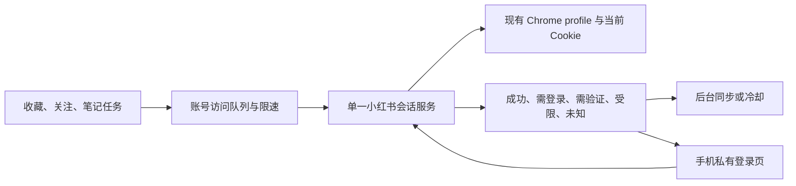

# 小红书少扫码方案：针对当前 RAG 与远程使用方式的详细建议

调研日期：2026-10-11。用户要求：延长两次需要人工登录之间的时间；电脑端安装、开发、配置和维护由助手完成；用户只能在手机上扫码、确认或输入验证码，不能到电脑旁操作。用户确认近期没有在其他电脑或浏览器登录小红书网页版。

本轮完成网络调研、源码检查、用户服务状态查询、脱敏日志回溯及数据库只读查询。没有改动采集程序、当前登录会话、网络配置、队列或服务。本报告描述待实现方案，不是已经部署或长期验收的功能。

## 推荐结论

推荐在现有项目中建立一个专门的小红书会话服务，独占现有持久 Chrome profile，让登录、笔记读取、收藏和关注同步使用同一份当前会话；同时统一账号访问节奏、区分风控与登录失效，并提供手机可用的登录处理页面。

这比单纯每六小时重新导出 Cookie 更适合当前情况。关键目标是减少本地会话不同步、重复请求和错误登录提示，让仍有效的登录尽可能持续被利用。平台决定真正的会话有效期，现有公开证据不能承诺实施后必定保持七天、三十天或永久免扫码。

## 本机证据：不能把下载暂停直接解释为整个账号掉线

以下时间均为 America/Chicago，2026-10-11 当天为 CDT，UTC−5。

| 时间 | 查到的事实 | 可以得出的结论 |
| --- | --- | --- |
| 10 月 10 日 18:01 | 收藏同步完成 22 页，2 条新提交、212 条重复 | 当时收藏 API 可用 |
| 10 月 10 日 22:30 | 关注续扫首次记录 `FOLLOWING_ENUMERATION_UNAVAILABLE` | 关注页面/响应没有成功取得；不是明确的会话过期证据 |
| 10 月 11 日 01:28 | 登录 Cookie 导出；随后签名账号接口验证成功，原账号匹配 | 本次登录确实成功，不只是在手机上点了确认 |
| 01:30:09—02:06:01 | 数据库有 119 个小红书 `download` 阶段为 `done` | 登录后下载曾持续工作；数量不是新入库知识条数 |
| 02:06:11 | 一次下载返回 `XHS_LOGIN_OR_VERIFICATION_REQUIRED`，触发小红书下载暂停 | 只知道认证或验证入口被拒绝；日志的 `platform_code` 为 null，无法确定是哪种限制 |
| 07:01 | 原 Cookie 文件没有重新导出，收藏同步仍完成 22 页，214 条重复，错误为空 | 同一份 Cookie 此时仍能访问收藏 API，不能把此前下载错误解释为所有接口都已登出 |
| 07:17 | 关注扫描继续工作，因队列积压进入 `backpressure`，错误为空 | 此状态不是登录失败 |
| 约 11:47 | 数据库 `xhs_login_required=true`；最新下载认证类阻塞仍是 02:06 的那一次 | 暂停标记保留了下来；不是持续测得新的登录失败 |

关注续扫日志在 22:30 后多次重复旧错误，其中后续记录明确有 `continuation_skipped=true`。源码会直接返回旧扫描状态，不发起新的续扫。因此多条 blocked 日志不能计作多次独立掉线。

本轮无法完整还原用户提到的两次扫码各自的触发原因，也没有通过再次触发风控来复现。诊断以现有记录为依据，以下工程缺口不能全部宣称为已证实根因。

本地证据来源：[登录与来源验收记录](../implementation/xhs-download-recovery-20261011.md)、私有 `.runtime/xhs-recovery-20261011/login-acceptance.json` 与 `resume-acceptance.json`、用户 systemd journal、PostgreSQL `rag_video_pipeline`/`rag_video_pipeline_control` 只读查询。脱敏核对结果见 [assessment JSON](xhs-session-assessment-20261011.json)。

## 当前实现的具体缺口

1. **持久 profile 已经存在，但没有统一管理它的常驻服务。** 登录脚本、关注读取、笔记读取都使用同一路径，已有文件锁防止同时打开；但每次笔记读取会重新启动并关闭 Chrome。当前 `xhs-session-check.timer` 和 `xhs-session-manager.service` 均为 `LoadState=not-found`，收藏、关注、关注续扫三个 timer 则为 active。不能把仓库存在服务模板等同于线上正在自动同步。[登录入口](../../examples/xhs_login.py)、[笔记入口](../../src/rag_favorite/video_sources.py)、[关注入口](../../src/rag_favorite/xhs_following_client.py)
2. **Cookie 存在多个状态副本。** 浏览器 profile、导出的 `cookies.txt`、签名客户端内存字典分别更新。签名客户端读取一次文件后，没有重新加载文件，也没有把 HTTP CookieJar 接收的更新写回；关注和笔记浏览器关闭前未统一发布最新 Cookie。这是可确认的一致性缺口，尚未证明它造成了这一次平台拒绝。[签名客户端](../../src/rag_favorite/xhs_client.py)
3. **请求环境不一致。** 本机是 Linux Chrome 154；网页访问使用真实 Chrome，独立 HTTP 请求写死 `User-Agent: Mozilla/5.0`，已安装的 xhshow 0.2.0 默认签名配置却是 Windows/Edge 142。应使用本机真实环境的一致信息，不能直接照搬其他项目的 macOS/Windows 值。此差异存在，但没有针对本账号的对照实验可证明其对登录寿命的影响。
4. **一篇笔记可能先被独立 HTTP 请求一次，再由 Chrome 打开一次。** 对已有完整长链接，前置 HTTP 请求增加了一次平台访问，且它被拒绝时，程序还没机会使用现有浏览器会话读取页面。应在同一会话内完成必要的链接解析与页面读取，避免无必要的重复访问。[下载入口](../../src/rag_favorite/video_sources.py)
5. **访问上限与账号实际负载没有统一。** 当前节流函数按调用间隔约三秒控制，但一次网页导航本身会产生多个请求；积压状态下的关注续扫仍会先读账号和关注列表再检查队列低水位。119 个下载阶段约 36 分钟完成时，还存在其他同步路径。这个事实不能单独证明限流，却足以说明“再加一个频繁心跳”不是当前首选。[节流](../../src/rag_favorite/xhs_client.py)、[续扫流程](../../src/rag_favorite/xhs_following.py)
6. **过期、验证码与访问限制被合并。** 部分 HTTP 状态及平台错误被映射成同一个登录/验证错误，控制台也显示需要重新登录或验证。自动处理需要先知道是哪种情况，不能每次都要求新二维码。[错误分类](../../src/rag_favorite/video_sources.py)、[暂停逻辑](../../src/rag_favorite/video_pipeline.py)

当前文件中 `web_session` 的本地到期日仍是 2027-10-11，`a1` 是 2027-10-04。这只能排除本地文件已经到期，不能证明服务器不会提前拒绝。正在运行的 worker 初始环境没有 HTTP/HTTPS/ALL_PROXY 变量；本轮没有证明公网出口长期稳定，也没有发现可据此认定的代理切换问题。

## 网络方案比较

| 方法 | 对当前问题的帮助 | 推荐程度 |
| --- | --- | --- |
| 修改 Cookie 的到期时间或把工具 TTL 改大 | 只能改变本地处理，无法改变平台的服务端判断 | 不采用 |
| 每几小时启动相同 profile，检查并导出 Cookie | 能修补快照不同步；无法单独解决下载风控、重复访问和错误分类 | 可作为服务内部的小功能 |
| 常驻专用 Chrome + 单一会话服务 + 统一访问调度 | 同时处理浏览器状态、Cookie 同步、重复启动和远程登录生命周期 | **首选** |
| 整体改用某个小红书 MCP/CLI | 仍依赖平台 Cookie，公开项目也有扫码成功但会话丢失/路径不一致等问题；还要迁移现有 RAG 的收藏、关注及恢复逻辑 | 不建议仅为少扫码而整体替换 |
| 官方 OAuth refresh token | 当前公开授权仅有基本用户信息，不能直接替代现有收藏、关注和笔记读取 | 当前不适用 |
| 高频刷新网页/心跳 | 没有找到可信的网页版永久续期证据，还会增加请求 | 不作为保活策略 |

MediaCrawler 使用持久 browser context，可说明 profile 复用是已有实践；Playwright 官方说明持久目录保存 Cookie 和 localStorage，且同一目录不能被多个浏览器实例同时启动。因此常驻服务必须独占 profile，现有采集进程改为向服务发请求。[MediaCrawler 源码](https://github.com/NanmiCoder/MediaCrawler/blob/main/media_platform/xhs/core.py)、[Playwright 持久 context](https://playwright.dev/python/docs/api/class-browsertype#browser-type-launch-persistent-context)

Playwright 的 `browser_context.request` 与浏览器共享 CookieJar，可以用于消除两个独立 Cookie 存储；但共享 Cookie 不等于共享浏览器完整网络指纹，也不会自动生成小红书业务签名。实际集成仍需以正常页面读取为优先，并单独验证保留的 API 路径。[Cookie 管理官方说明](https://playwright.dev/python/docs/api/class-apirequestcontext)、[认证状态边界](https://playwright.dev/python/docs/auth#session-storage)

xiaohongshu-cli 的七天 TTL 是本地重新提取策略，提取失败仍保留旧 Cookie；它还将二维码流程改为由真实浏览器完成，避免把不完整登录当成成功。公开 MCP issue 也记录过二维码显示后浏览器过早关闭、以及登录工具与服务 Cookie 路径不一致。这些案例支持完善会话生命周期，不证明工具切换能延长平台期限。[TTL 源码](https://github.com/jackwener/xiaohongshu-cli/blob/main/xhs_cli/cookies.py)、[浏览器登录改造提交](https://github.com/jackwener/xiaohongshu-cli/commit/5189df89f1919e54e9f60ec3a15b39a402919db8)、[MCP #599](https://github.com/xpzouying/xiaohongshu-mcp/issues/599)、[MCP #620](https://github.com/xpzouying/xiaohongshu-mcp/issues/620)

xhshow 自己把 SessionManager 标为实验性、实际效果待验证。维持其请求序列与 UA 一致可以作为实现细节，但不能据此承诺免扫码。官方 OAuth 的 refresh token 也有固定生命周期，且能力范围不覆盖这里的采集。[xhshow 说明](https://github.com/Cloxl/xhshow#会话管理实验性)、[官方 Scope](https://openaccount.xiaohongshu.com/docs/scope)、[官方 FAQ](https://openaccount.xiaohongshu.com/docs/faq)

## 推荐方案如何工作

**保留现有会话。** 首次部署先备份，在安全排空浏览器使用后接管原 profile。只要当前会话有效，就直接复用；无需为了部署再制造一次扫码。服务崩溃或电脑重启后重新加载同一 profile。常驻的目的主要是状态一致，不是用不停刷新页面强行续期。

**登录和采集使用同一状态。** 账号相关访问串行调度；客户端不再各自开浏览器。正常响应更新的 Cookie 自动同步，兼容旧读取路径时使用原子导出和版本号，读取前加载最新版本。持久化保留 domain/path/expiry 等语义，不能只按 Cookie 名字随意合并。

**先降低集中访问。** 以少扫码优先，建议试运行从每小时最多约 60 个新笔记读取、账号访问单并发起步；收藏与关注分页也计入同一账号预算，积压时跳过无必要的重复关注枚举。60 是针对当前约 119/36 分钟的保守工程起点，不是小红书公布的安全阈值，也不保证不会风控。代价是历史笔记补录变慢；模型处理已下载素材可继续独立推进。

**故障先分类再处理。** 浏览器仍登录而快照落后时，后台重新同步并只重试一次；网络失败使用有上限的退避；验证码或 IP 限制暂停相关读取并记录原因；单篇笔记失效不要求整个账号重登。即使账号接口可用，也不能仅凭这一点自动解除下载暂停，仍需该下载路径的一个小样本验证。

**不通过反复重登录处理未知结果。** 未识别页面、临时空白页、提取失败归为 unknown，保留原 profile 和 Cookie，等待下一次有界检查。仅当同一浏览器明确显示需要登录、且账号校验与页面证据一致时，才展示新的登录二维码。一次登录只保留一个活动尝试，刷新二维码也不新建 profile。

## 用户不在电脑旁时的实现方式

| 环节 | 助手可以完成 | 用户需要做 |
| --- | --- | --- |
| 安装、代码、服务、日志和恢复 | 全部电脑端工作 | 无需操作电脑 |
| 当前会话有效时迁移 | 接管原 profile，验证原账号和小样本 | 通常无需动作 |
| 确实需要重新登录 | 保持浏览器运行，显示真实二维码并等完整回调 | 手机扫码并确认 |
| 短信验证 | 手机页面接收验证码并填入同一浏览器，处理后立即清除 | 输入本人收到的验证码 |
| 浏览器滑块或点选验证 | 提供该登录页面的手机交互视图 | 在手机页面完成平台要求的操作 |
| 登录完成 | 校验账号匹配、验证读取、同步会话、受控恢复 | 无需手动导出 Cookie |

用户已有 Tailscale Serve 私有入口，当前配置指向本机 8765，Funnel 未启用，可优先扩展现有认证控制台。当前控制台尚没有上表所述的小红书远程登录页；不能把现有私有路由配置当成新功能已验收。验证码只给二维码图片时不一定能完成，因此手机交互视图是满足“不到电脑旁”约束的重要部分。

本机已有 Google Chrome、Playwright、可用桌面 DISPLAY 和 xauth，尚无 Xvfb/xvfb-run。可以先沿用现有可用浏览器方式；需要独立虚拟显示时由助手补齐依赖并验证。仓库旧会话服务模板直接调用 xvfb-run，且默认目录/状态格式与当前 RAG 不同，所以不能只把旧 timer 启用就宣称接通。Linux 虚拟显示运行有头浏览器在 Playwright 官方文档有说明，但这不构成“有头模式一定更少风控”的证据。[官方运行方式](https://playwright.dev/docs/ci#running-headed)

二维码、短信及可在网页完成的验证可按上述方式远程处理。平台如果额外要求手机 App 内实名或设备验证，仍由用户在手机端完成；不能承诺所有情况下都只需要扫一次码。

## 实施顺序与效果验收

1. 建立准确的状态与事件记录：区分真登录失效、验证码、限流、IP 限制、笔记不可用、未知；记录最后真实成功时间与接口类别。日志不保存 Cookie、短信码或带令牌链接。
2. 建立会话服务并接管原 profile：统一锁、状态目录、浏览器配置、Cookie 发布和客户端刷新。优先利用旧模块中的原子导出与探测能力，不直接启动带旧队列恢复逻辑的整套 CLI。
3. 接入笔记、收藏和关注：删除不必要的前置请求，统一真实 UA 与相关签名配置，实施账号总预算、缓存、退避和暂停判断。
4. 增加手机登录页：二维码等待、过期更新、短信输入、浏览器验证交互与账号绑定校验。完成手机尺寸与交互检查。
5. 离线验证状态机、并发唯一性、Cookie 更新和服务重启保留；再用原账号低频验证账号及少量来源，记录通过与失败边界。
6. 在有实际同步负载的情况下观察 72 小时，再观察七天。记录人工扫码次数、成功读取量、受限次数、每次干预原因，以及浏览器内存与稳定性。不能通过停止全部采集来得到“七天未掉线”。

72 小时和七天是建议的观察窗口，不是已经实现的结果。现阶段能够负责地推荐这条实施路径，也可以承担其电脑端实现；不能在实施前给出“登录寿命极大延长”的确定比例。当前证据最支持的收益是消除不必要重登、会话错位和重复请求，平台真实风控仍需实际运行验证。
